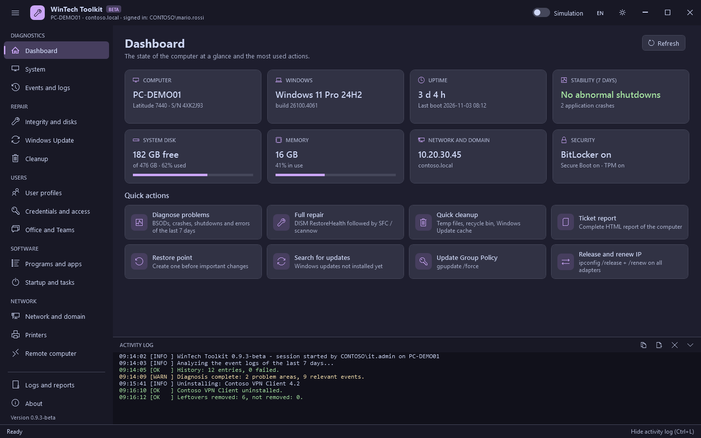

# WinTech Toolkit - User guide

[Italiano](../it/README.md)

WinTech Toolkit collects in one window the checks and repairs an IT technician runs every day on
Windows 10 and 11: event analysis, system file repair, Windows Update, cleanup, user profiles,
credentials, Office, programs, network and printers.

## Contents

| Group | Sections | Page |
|---|---|---|
| Diagnostics | Dashboard, System, Events and logs | [diagnostics.md](diagnostics.md) |
| Repair | Integrity and disks, Windows Update, Cleanup | [repair.md](repair.md) |
| Users | User profiles, Credentials and access, Office and Teams | [users.md](users.md) |
| Software | Programs and apps, Startup and tasks | [software.md](software.md) |
| Network | Network and domain, Printers, Remote computer | [network.md](network.md) |

## Starting the toolkit

| Method | How |
|---|---|
| From the web | In PowerShell (no need to be admin): `irm https://raw.githubusercontent.com/SlaKy03/WinTechToolkit/main/start.ps1 \| iex`. The latest release is downloaded, checked against its SHA-256 file and started from a temporary folder. |
| Executable | `WinTechToolkit.exe` from the [releases](https://github.com/SlaKy03/WinTechToolkit/releases/latest). It looks for the latest version and checks it (SHA-256); with no network, if the check fails, or with `WinTechToolkit.exe /offline`, it uses the embedded version. The extracted files are deleted when you close it. |
| From a folder | Download the zip, extract it and double-click `Start-WinTechToolkit.cmd`. |

The toolkit asks for administrator rights (UAC) and always runs in 64-bit Windows PowerShell 5.1.
It is often started with a separate administrator account: the header shows both the user signed
in to the PC and, if different, the account the toolkit runs as.

## The window

| Area | What it does |
|---|---|
| Menu on the left | The sections, grouped. The button with three lines collapses it to icons only. `Ctrl+1`...`Ctrl+9` open the first nine sections. |
| Title bar | Computer name, domain and signed-in user; **Simulation** switch, language (EN/IT), light/dark theme. |
| Activity log | At the bottom: everything the toolkit does, with the result (green OK, yellow warnings, red errors). `Ctrl+L` hides or shows it. The same lines are saved to the log file. |
| Status bar | The operation in progress, the queue and the **Stop** button. |

Other keys: `F5` refreshes the open section, `Ctrl+F` goes to its search box.

Operations run one at a time: if you start another one, it waits in the queue (shown in the status
bar). Lists and summaries load in the background while you work. When an operation of 15 seconds or
more ends with the window in the background, the taskbar button flashes and a notification appears.

## Simulation mode

With **Simulation** on, operations that change the system (uninstall, delete, reset, repair...)
are only described in the activity log: nothing is changed. Use it the first time you use a
function on a PC, or to show a user what would happen. Read-only functions (lists, reports, scans)
work as usual.

## Safety

- **Confirmation** before every operation that changes something, with the list of what will be
  changed.
- **Registry backups**: every registry key is exported to a `.reg` file before it is deleted
  (`C:\ProgramData\WinTechToolkit\Backup\<date>`). Double-click it to restore the key.
- **Restore point**: offered before uninstalling programs; you can create one at any time.
- **Protected paths**: no function deletes Windows, Program Files, ProgramData, the profiles
  folder, the personal folders of a profile (Documents, Desktop, AppData...), the profiles Windows
  uses for itself (defaultuser0) or the folder the toolkit runs from. These protections are
  checked automatically on every change of the code.
- **Protected profiles and apps**: loaded profiles, the account in use and system profiles cannot
  be deleted; Store apps needed by Windows (Store, App Installer, Windows Security, Edge, runtimes)
  cannot be removed.

## Data saved by the toolkit

Everything is in `C:\ProgramData\WinTechToolkit`:

| Folder | Content |
|---|---|
| `Logs` | Daily log of the activity, uninstall logs (msiexec), crash reports of the interface |
| `Report` | HTML reports, exported CSV files, SFC details, Wi-Fi and battery reports |
| `Backup` | `.reg` backups of the deleted registry keys |
| `settings.json` | Theme, language, window size and position |

**Logs and reports** in the menu opens the folder. When you close the toolkit a confirmation
appears, with the option **Also delete the toolkit data**: tick it to leave nothing on the PC (the
registry backups are deleted too).

## Reporting a problem

**About > Report a problem** opens a new issue on GitHub; **Copy info** copies the version,
Windows and PowerShell to paste in it. Attach the activity log (copy button in the log panel).
