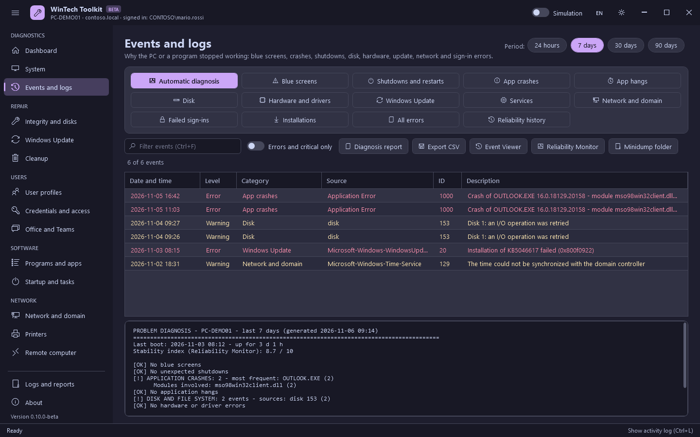

# Diagnostics

[Guide](README.md) · [Italiano](../it/diagnostics.md)

Sections that only read information: nothing here changes the system, except the restore point.

## Dashboard

The state of the computer at a glance, loaded at startup (`F5` or **Refresh** to update it).

| Card | What it shows |
|---|---|
| Computer | Name, model and serial number |
| Windows | Edition, version and build |
| Uptime | Time since the last boot; yellow after 14 days or if a restart is pending |
| Stability (7 days) | Blue screens, unexpected shutdowns and application crashes |
| Memory | RAM in use and available, **updated every second**, with a bar (yellow at 90%) |
| System disk | Free space with a bar (yellow at 80%, red at 90%) and, updated every second, the disk activity and the read and write speed |
| Network and domain | IP address and domain |
| Security | BitLocker, Secure Boot and TPM; yellow if BitLocker is off |

Below the cards, two charts show the **memory in use** and the **disk activity** of the last
minute, like Task Manager. Memory, disk and charts are updated only while the Dashboard is on
screen.

**Quick actions** are shortcuts to the most used functions:

| Action | What it runs |
|---|---|
| Diagnose problems | Opens Events and logs with the automatic diagnosis of the last 7 days |
| Full repair | DISM RestoreHealth followed by SFC /scannow (see [Repair](repair.md)) |
| Quick cleanup | Windows and user temp files, Windows Update and Delivery Optimization caches, recycle bin |
| Ticket report | The HTML report of the System section |
| Restore point | Creates a restore point |
| Search for updates | Opens Windows Update and starts the search |
| Update Group Policy | `gpupdate /force` |
| Release and renew IP | `ipconfig /release` and `/renew` on all adapters |

## System

| Button | What it does | Changes the system |
|---|---|---|
| Refresh / Save as text / Copy | Full inventory (hardware, Windows, disks, network, security), saved to a text file or copied | No |
| Create HTML report | A complete report to attach to a ticket: summary, event diagnosis, disks, network, programs, startup items, administrators, printers, updates and the activity of this session. The technician's notes are added at the top. The report is in English, so it is the same in every ticket. | No |
| Create restore point | `Checkpoint-Computer`; the one-per-24-hours limit of Windows is bypassed for this call (`SystemRestorePointCreationFrequency`) | Yes |
| Battery report | `powercfg /batteryreport` (laptops): capacity, wear and battery history | No |
| Devices with problems | Devices with an error in Device Manager, with the meaning of the code | No |
| BitLocker recovery key | The 48-digit recovery password of the volumes, shown on screen and never written to the log | No |
| Windows consoles | Computer Management, Device Manager, Services, Event Viewer, Programs and Features, Network Connections and others | No |

## Events and logs

Why the PC or a program stopped working. Choose the period at the top right (24 hours, 7, 30 or
90 days) and a category.

| Category | What it reads |
|---|---|
| Automatic diagnosis | Everything below, summarized with **[!]** for the problems found and numbered **suggestions** (likely cause and what to do). Blue screens show the stop code with its meaning. |
| Blue screens | BSODs (BugCheck 1001) with the stop code and its likely cause |
| Shutdowns and restarts | Kernel-Power 41 (unexpected), 6008 (unclean shutdown), 6005/6006 (start/stop of the log), 1074 (who asked for the restart) |
| App crashes | Application Error 1000 (program, module, exception) and .NET Runtime 1026 |
| App hangs | Application Hang 1002 (program not responding) |
| Disk | Errors and warnings of disk, NTFS, volmgr and storage controllers (AHCI, NVMe, Intel RST, StorPort) |
| Hardware and drivers | WHEA errors, video driver recovered (Display 4101), drivers not loaded (Kernel-PnP 219/411), virtual memory exhausted (2004) |
| Windows Update | Errors of the Windows Update client and of the Setup log |
| Services | Service Control Manager errors (services that stopped or did not start) |
| Network and domain | Netlogon, Group Policy, DHCP client and time service errors, DNS timeouts (1014), IP conflicts (Tcpip 4199) |
| Failed sign-ins | Security log 4625 (wrong password) and 4740 (account locked) |
| Installations | MSI installations and removals (MsiInstaller) and updates installed |
| All errors | Every error and critical event of the System and Application logs |
| Reliability history | Reliability Monitor records: crashes, Windows errors, installations and updates |

Select an event to read its full text with an interpretation. Other buttons: **Diagnosis report**
(the last report again), **Export CSV**, **Event Viewer**, **Reliability Monitor**, **Minidump
folder**. The switch **Errors and critical only** hides warnings.
