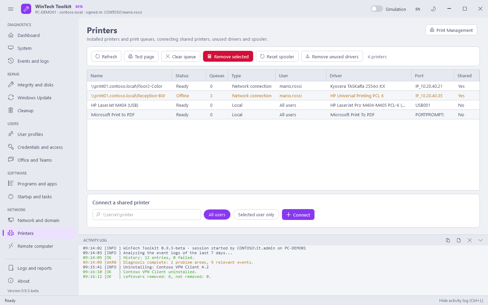

# Network

[Guide](README.md) · [Italiano](../it/network.md)

## Network and domain

The adapters with IP, gateway, DNS and DHCP, then the actions.

| Button | Command | Changes the system |
|---|---|---|
| Release IP / Renew IP / Release and renew | `ipconfig /release`, `/renew` or both, on all adapters | Yes |
| Flush DNS cache | `ipconfig /flushdns` | Yes |
| Register in DNS | `ipconfig /registerdns`: updates the record of the PC in the domain DNS | Yes |
| Full configuration | `ipconfig /all` in the activity log | No |
| Connectivity test | Gateway, DNS resolution, HTTPS to a few sites and the WinHTTP proxy | No |
| Port test (Check) | Opens a TCP connection to `host:port` (e.g. a server on 443 or 3389) | No |
| Wi-Fi report | `netsh wlan show wlanreport`: Wi-Fi sessions, disconnections and errors of the last days (HTML) | No |
| Reset Winsock and TCP/IP | `netsh winsock reset`, `netsh int ip reset`, `ipconfig /flushdns`. **Requires a restart** | Yes |
| gpupdate /force | Computer and user policies | Yes |
| gpupdate computer only | `gpupdate /target:computer /force` | Yes |
| Applied policies report | `gpresult /h` for the computer and the signed-in user (HTML) | No |
| Check domain trust | `Test-ComputerSecureChannel` and `nltest /sc_query` | No |
| Repair domain trust | `Test-ComputerSecureChannel -Repair` with an account allowed to join computers (asked when you press it): for "the trust relationship between this workstation and the primary domain failed" | Yes |
| Sync time | `w32tm /resync /force` (Kerberos tolerates 5 minutes of difference) | Yes |
| Restart Explorer | Ends and restarts `explorer.exe`: frozen taskbar or desktop | Yes |

## Printers

The printers of the computer and the **network printers of every signed-in user**. A network
connection (`\\server\queue`) belongs to one user: when the toolkit runs with another administrator
account Windows does not show it, so it is read from the user's registry. The **User** column says
whose it is; its status, driver and queue are only visible in that user's session.

| Button | What it does | Changes the system |
|---|---|---|
| Test page | Prints the Windows test page | No |
| Clear queue | Deletes the jobs in the queue of the selected printers | Yes |
| Remove selected | Removes the printers. The network printer of another user is removed in their session; a connection for all users (`printui /ga`) is removed too | Yes |
| Reset spooler | Stops the spooler, empties `C:\Windows\System32\spool\PRINTERS` (stuck jobs) and starts it again | Yes |
| Remove unused drivers | Removes the drivers not used by any printer (Microsoft drivers excluded), also from the driver store. The drivers used in the session of each signed-in user are read first: if that fails, nothing is removed | Yes |
| Connect a shared printer | `\\server\printer` for **all users** (`printui /ga`, appears at the next sign-in) or for the **selected user only** (right away, in their session) | Yes |
| Print Management | Opens `printmanagement.msc` | No |

## Remote computer

The same functions on another PC through **WinRM** (PowerShell remoting): the code travels with
the request, nothing is installed on the remote PC. The remote PC needs WinRM enabled
(`Enable-PSRemoting` or Group Policy) and port 5985 open.

| Button | What it does |
|---|---|
| Test connection | Checks that WinRM answers (optionally with another account: **Use a different account**) |
| Remote Desktop / Computer Management | Open `mstsc` and `compmgmt.msc` on the remote PC |
| Inventory, Diagnose problems, Disk health, User profiles, Installed programs, Local administrators, Update history, Cleanup analysis | Read-only: the result appears in the box below (Copy / Save) |
| Quick cleanup, Full repair, gpupdate /force, Flush DNS cache, Sync time, Reset spooler | Change the remote PC (red icon) and respect the Simulation mode |
