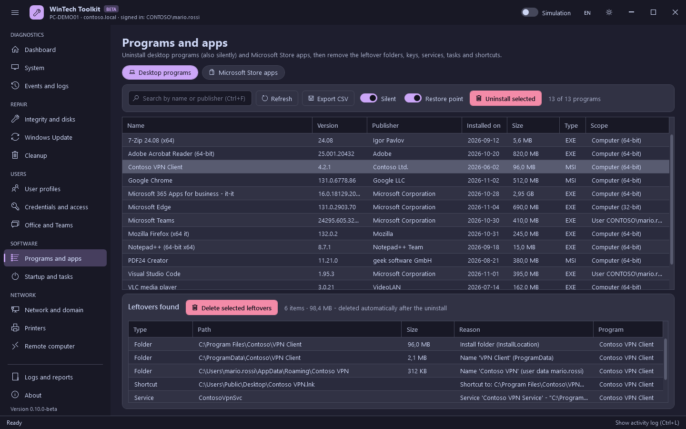

# Software

[Guide](README.md) · [Italiano](../it/software.md)

## Programs and apps

Two tabs, both loaded when the toolkit starts. Click a program or an app: the **leftovers** it
would leave behind appear at the bottom right away, without pressing anything.

### Desktop programs

The programs of Apps and features: installed for the computer (64 and 32 bit) or for a user.

| Button / switch | What it does | Changes the system |
|---|---|---|
| Search (Ctrl+F) | Filters by name or publisher. If **no installed program** matches a text of at least 4 characters (e.g. `Zoom` already uninstalled), the leftovers whose name contains it are searched: this finds what is left of programs removed without the toolkit | No |
| Export CSV | The list with version, publisher, size, uninstall command | No |
| Silent | Uninstalls without windows: MSI with `msiexec /x {code} /qn`, otherwise the program's `QuietUninstallString`, or the switch of Inno Setup (`/VERYSILENT`) or NSIS (`/S`) detected automatically. If no silent mode is known, the normal uninstaller opens | - |
| Restore point | Creates a restore point before uninstalling | - |
| Uninstall selected | Uninstalls, then **deletes the leftovers automatically** (see below) | Yes |

Right-click a program: open the install folder, open its registry key, copy the uninstall
command, search the web.

### Microsoft Store apps

The Appx/MSIX apps of every user, with the name shown in Start. Apps that Windows or other apps
need (Microsoft Store, App Installer/winget, Windows Security, Edge, runtimes) are greyed out and
never removed.

| Column / switch | Meaning |
|---|---|
| Source | **Microsoft Store**: signed by the Store. **Outside the Store**: signed by the publisher, it may come with Windows or the PC maker, from winget or from an `.msix` file. **Company**: company certificate |
| Installed for | Users that have the app |
| New users | Yes if the app is in the Windows image (it is installed for every new user) |
| Also for new users | Also removes the app from the Windows image (`Remove-AppxProvisionedPackage`), so it does not come back for new users |
| Remove selected apps | `Remove-AppxPackage -AllUsers`, then deletes the leftovers automatically |

### Leftovers

After an uninstall the toolkit looks for what the program left and **deletes it automatically**:

| Type | Where |
|---|---|
| Folders | Install folder, Program Files, ProgramData, AppData of every user (also the publisher folder, if left empty) |
| Shortcuts | Start menu and desktop (also the ones pointing to the deleted folders) |
| Registry | Keys named after the program or the publisher (HKLM and every loaded user), the uninstall entry, the Windows Installer registration |
| Services and tasks | Services and scheduled tasks that start files from the deleted folders |
| Store apps | `AppData\Local\Packages\<app>` of every profile and, for the signed-in users, app settings, package registration and file associations in the registry |

Safety rules:

- leftovers are deleted automatically **only if the uninstall completed**: otherwise they would
  include the files of a program that is still installed, so they are listed to be checked;
- registry keys are saved to `.reg` before deletion; processes running from the folders are closed;
- names used by other installed programs, generic or system names (Microsoft, Windows, Common
  Files...) and the protected paths are never proposed;
- folders with files in use are deleted at the next restart: in that case, and when the uninstaller
  asks for it, a message offers to **restart now** (in 60 seconds).

**Delete selected leftovers** deletes only the selected rows (`Ctrl+A` selects all), without
uninstalling: for the leftovers of programs already removed. If the program is still installed,
the confirmation warns that it may stop working.

## Startup and tasks

| Button | What it does | Changes the system |
|---|---|---|
| Startup programs: Disable / Enable | The Run keys (computer, 32-bit, every loaded user) and the Startup folders. Disabling uses the `StartupApproved` keys, like Task Manager: nothing is deleted and **Enable** restores it | Yes |
| Scheduled tasks: Disable / Enable | `Disable-ScheduledTask` / `Enable-ScheduledTask`. Windows tasks are hidden unless **Include Windows tasks** is on | Yes |
| Task Manager / Task Scheduler | Open the Windows consoles | No |
