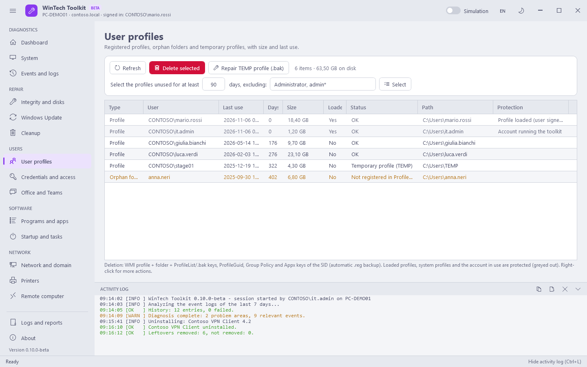

# Users

[Guide](README.md) · [Italiano](../it/users.md)

Many user problems live in the user's own session (credentials, Kerberos tickets, Office sign-in,
OneDrive). The toolkit often runs with a separate administrator account: these actions are run
**in the session of the signed-in user** through a temporary scheduled task, removed when done.
They are marked with "Session" and need the user to be signed in (a dot next to the name).

## User profiles

The list of the profiles with real last use, size, state and the reason why a profile is protected.

| Type / state | Meaning |
|---|---|
| Profile | A registered profile (ProfileList) |
| Backup .bak | A `<SID>.bak` key: Windows could not load the profile and created a temporary one |
| Temporary profile (TEMP) | The user signs in to `C:\Users\TEMP`: their data is not lost, see **Repair TEMP profile** |
| Orphan folder | A folder in `C:\Users` not linked to any profile (leftover of a deleted account) |
| Folder missing | Registered profile whose folder no longer exists |

| Button | What it does | Changes the system |
|---|---|---|
| Select (days, excluding) | Selects the profiles not used for at least N days, except the names in the list (wildcards allowed, e.g. `admin*`) | No |
| Delete selected | Deletes the WMI profile, the folder, the ProfileList and `.bak` keys, ProfileGuid, Group Policy and Appx keys of the SID. Every key is saved to `.reg` first | Yes |
| Repair TEMP profile (.bak) | Deletes the SID key that points to TEMP and renames `SID.bak` back to `SID`, resetting its state: at the next sign-in the user finds their profile again | Yes |

Never shown and never deleted: profiles loaded (user signed in), the account running the toolkit,
system profiles, paths outside `C:\Users`, and the accounts Windows creates for itself
(`defaultuser0`, `defaultuser100000`, `WsiAccount`).

## Credentials and access

| Button | What it does | Changes the system |
|---|---|---|
| Read credentials | Session · lists the Credential Manager entries of the selected user | No |
| Delete selected | Session · deletes the selected entries (after a password change, old saved passwords lock the account) | Yes |
| Select Office/Teams/OneDrive | Selects the Microsoft 365 entries, to sign in again from scratch | No |
| Show user tickets | Session · `klist` | No |
| Purge user tickets | Session · `klist purge`: new groups and passwords apply without signing out | Yes |
| Purge computer tickets | `klist -li 0x3e7 purge`: new computer groups apply without a restart | Yes |
| Reset PIN and Windows Hello | Session · `certutil -DeleteHelloContainer`: for "PIN not available" or "something went wrong with your PIN". The user sets a new PIN at the next sign-in | Yes |
| Local groups: Add | `net localgroup <group> <member> /add` on Administrators, Remote Desktop Users or Users (`DOMAIN\user`, `DOMAIN\group`, `AzureAD\user@domain` or a local user) | Yes |
| Local groups: Remove selected | Removes the members through ADSI (`WinNT://`), which also works for orphaned SIDs. Changes apply at the user's next sign-in | Yes |

Orphaned SIDs (accounts that no longer exist) are shown in yellow and can be removed; the account in
use and the built-in administrator are protected.

## Office and Teams

| Button | What it does | Changes the system |
|---|---|---|
| Quick repair | `OfficeClickToRun.exe scenario=Repair RepairType=QuickRepair`: offline, a few minutes, fixes most crashes | Yes |
| Online repair | Same with `RepairType=FullRepair`: reinstalls Office from the Internet (slow) | Yes |
| Update Office | `OfficeC2RClient.exe /update user`: starts the update check | Yes |
| Clear Teams cache | Closes Teams and empties the cache of the new Teams (`MSTeams` package) and of classic Teams: slowness, chats or images that do not load | Yes |
| Reset sign-in and license | Session · removes the Office Identity, Licensing and Registration keys, the identity caches (IdentityCache, OneAuth) and the saved Office credentials: for constant sign-in prompts or "unlicensed product" | Yes |
| Rebuild Outlook cache | Renames the `.ost` files: Outlook downloads the mailbox again | Yes |
| Outlook in safe mode | Session · `outlook /safe`, without add-ins | No |
| Reset navigation pane | Session · `outlook /resetnavpane`: Outlook does not open or closes immediately | Yes |
| Reset OneDrive | Session · `onedrive.exe /reset` and restart of the client: sync stuck. Local files are kept | Yes |
