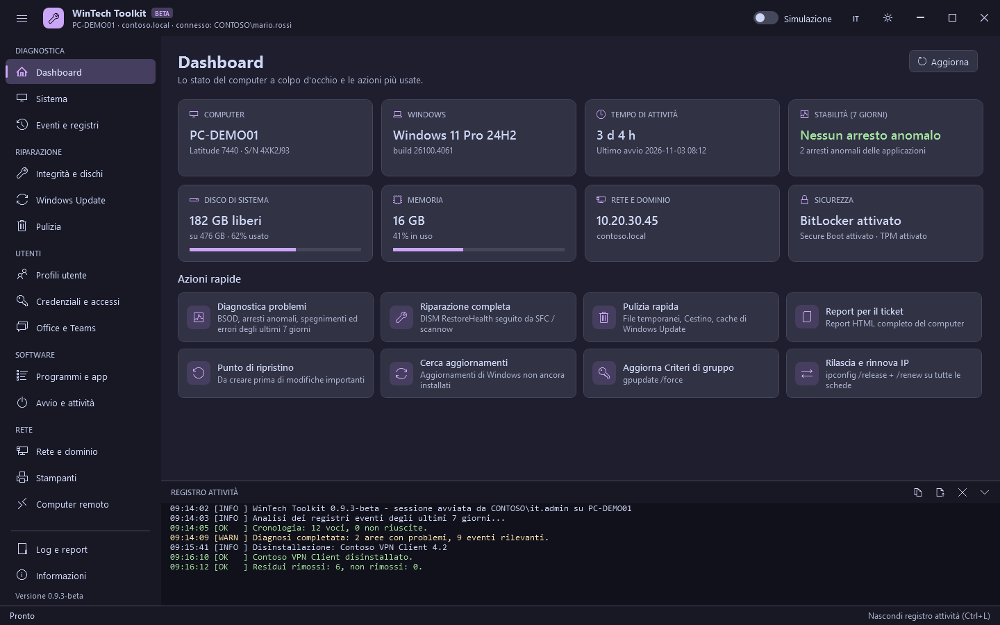

# WinTech Toolkit - Guida

[English](../en/README.md)

WinTech Toolkit raccoglie in una sola finestra i controlli e le riparazioni che un tecnico IT fa
ogni giorno su Windows 10 e 11: analisi degli eventi, riparazione dei file di sistema, Windows
Update, pulizia, profili utente, credenziali, Office, programmi, rete e stampanti.

## Indice

| Gruppo | Sezioni | Pagina |
|---|---|---|
| Diagnostica | Dashboard, Sistema, Eventi e registri | [diagnostics.md](diagnostics.md) |
| Riparazione | Integrità e dischi, Windows Update, Pulizia | [repair.md](repair.md) |
| Utenti | Profili utente, Credenziali e accessi, Office e Teams | [users.md](users.md) |
| Software | Programmi e app, Avvio e attività | [software.md](software.md) |
| Rete | Rete e dominio, Stampanti, Computer remoto | [network.md](network.md) |

## Avvio

| Modo | Come |
|---|---|
| Dal web | In PowerShell (non serve essere amministratore): `irm https://raw.githubusercontent.com/SlaKy03/WinTechToolkit/main/start.ps1 \| iex`. Scarica l'ultima versione, la verifica con il file SHA-256 e la avvia da una cartella temporanea. |
| Eseguibile | `WinTechToolkit.exe` dalle [release](https://github.com/SlaKy03/WinTechToolkit/releases/latest). Cerca l'ultima versione e la verifica (SHA-256); senza rete, se la verifica non riesce o con `WinTechToolkit.exe /offline` usa la versione inclusa. I file estratti vengono eliminati alla chiusura. |
| Da una cartella | Scarica lo zip, estrailo e fai doppio clic su `Start-WinTechToolkit.cmd`. |

Il toolkit chiede i diritti di amministratore (UAC) e gira sempre in Windows PowerShell 5.1 a
64 bit. Spesso si avvia con un account amministratore diverso: l'intestazione mostra l'utente
connesso al PC e, se diverso, l'account con cui gira il toolkit.

## La finestra

| Zona | A cosa serve |
|---|---|
| Menu a sinistra | Le sezioni, raggruppate. Il pulsante con tre linee lo riduce alle sole icone. `Ctrl+1`...`Ctrl+9` aprono le prime nove sezioni. |
| Barra del titolo | Nome del computer, dominio e utente connesso; interruttore **Simulazione**, lingua (EN/IT), tema chiaro/scuro. |
| Registro attività | In basso: tutto quello che fa il toolkit, con l'esito (verde OK, giallo avvisi, rosso errori). `Ctrl+L` lo nasconde o lo mostra. Le stesse righe vengono salvate nel file di log. |
| Barra di stato | L'operazione in corso, la coda e il pulsante **Stop**. |

Altri tasti: `F5` aggiorna la sezione aperta, `Ctrl+F` porta alla sua casella di ricerca.

Le operazioni partono una alla volta: se ne avvii un'altra, aspetta in coda (indicata nella barra
di stato). Elenchi e riepiloghi si caricano in background mentre lavori. Quando un'operazione di
almeno 15 secondi finisce con la finestra in secondo piano, il pulsante sulla barra delle
applicazioni lampeggia e compare una notifica.

## Modalità simulazione

Con **Simulazione** attiva, le operazioni che modificano il sistema (disinstallare, eliminare,
reimpostare, riparare...) vengono solo descritte nel registro attività: non cambia nulla. Usala la
prima volta che provi una funzione su un PC, o per mostrare a un utente cosa succederebbe. Le
funzioni di sola lettura (elenchi, report, analisi) funzionano normalmente.

## Sicurezza

- **Conferma** prima di ogni operazione che modifica qualcosa, con l'elenco di cosa verrà cambiato.
- **Backup del registro**: ogni chiave viene esportata in un file `.reg` prima di essere eliminata
  (`C:\ProgramData\WinTechToolkit\Backup\<data>`). Doppio clic sul file per ripristinarla.
- **Punto di ripristino**: proposto prima di disinstallare programmi; puoi crearne uno quando vuoi.
- **Percorsi protetti**: nessuna funzione elimina Windows, Programmi, ProgramData, la cartella dei
  profili, le cartelle personali di un profilo (Documenti, Desktop, AppData...), i profili che
  Windows usa per sé (defaultuser0) o la cartella da cui gira il toolkit. Queste protezioni vengono
  verificate automaticamente a ogni modifica del codice.
- **Profili e app protetti**: profili caricati, account in uso e profili di sistema non si possono
  eliminare; le app dello Store necessarie a Windows (Store, App Installer, Sicurezza di Windows,
  Edge, runtime) non si possono rimuovere.

## Dati salvati dal toolkit

Tutto si trova in `C:\ProgramData\WinTechToolkit`:

| Cartella | Contenuto |
|---|---|
| `Logs` | Log giornaliero delle attività, log delle disinstallazioni (msiexec), segnalazioni di errori dell'interfaccia |
| `Report` | Report HTML, file CSV esportati, dettagli SFC, report Wi-Fi e batteria |
| `Backup` | Backup `.reg` delle chiavi di registro eliminate |
| `settings.json` | Tema, lingua, dimensione e posizione della finestra |

**Log e report** nel menu apre la cartella. Alla chiusura del toolkit compare una conferma con
l'opzione **Elimina anche i dati del toolkit**: spuntala per non lasciare nulla sul PC (vengono
eliminati anche i backup del registro).

## Segnalare un problema

**Informazioni > Segnala un problema** apre una nuova segnalazione su GitHub; **Copia informazioni** copia
versione, Windows e PowerShell da incollarvi. Allega il registro attività (pulsante copia nel
pannello del registro).
