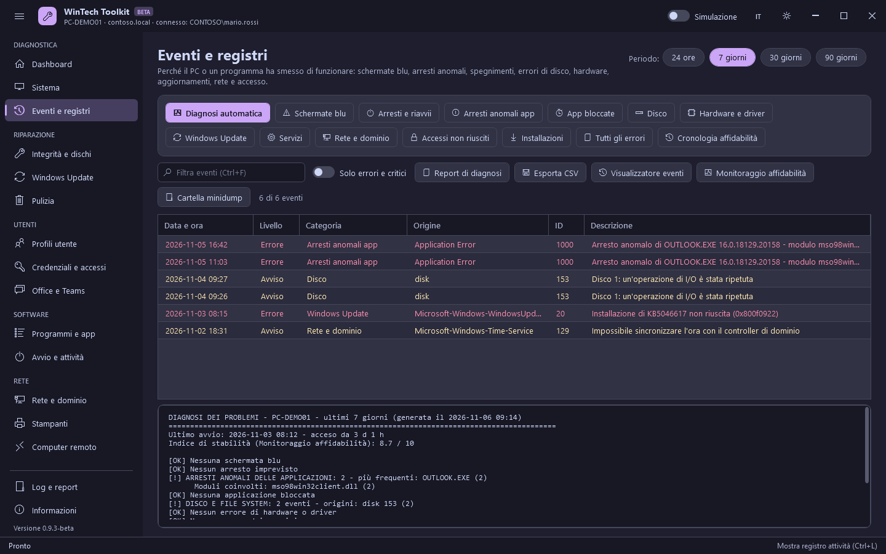

# Diagnostica

[Guida](README.md) · [English](../en/diagnostics.md)

Sezioni che leggono soltanto informazioni: qui nulla modifica il sistema, tranne il punto di
ripristino.

## Dashboard

Lo stato del computer a colpo d'occhio, caricato all'avvio (`F5` o **Aggiorna** per aggiornarlo).

| Riquadro | Cosa mostra |
|---|---|
| Computer | Nome, modello e numero di serie |
| Windows | Edizione, versione e build |
| Tempo di attività | Tempo dall'ultimo avvio; giallo dopo 14 giorni o se è in attesa un riavvio |
| Stabilità (7 giorni) | Schermate blu, arresti imprevisti e arresti anomali delle applicazioni |
| Disco di sistema / Memoria | Spazio libero e RAM in uso, con barra (gialla all'80%, rossa al 90%) |
| Rete e dominio | Indirizzo IP e dominio |
| Sicurezza | BitLocker, Secure Boot e TPM; giallo se BitLocker è disattivato |

Le **azioni rapide** sono scorciatoie alle funzioni più usate:

| Azione | Cosa esegue |
|---|---|
| Diagnostica problemi | Apre Eventi e registri con la diagnosi automatica degli ultimi 7 giorni |
| Riparazione completa | DISM RestoreHealth seguito da SFC /scannow (vedi [Riparazione](repair.md)) |
| Pulizia rapida | File temporanei di Windows e degli utenti, cache di Windows Update e Ottimizzazione recapito, Cestino |
| Report per il ticket | Il report HTML della sezione Sistema |
| Punto di ripristino | Crea un punto di ripristino |
| Cerca aggiornamenti | Apre Windows Update e avvia la ricerca |
| Aggiorna Criteri di gruppo | `gpupdate /force` |
| Rilascia e rinnova IP | `ipconfig /release` e `/renew` su tutte le schede |

## Sistema

| Pulsante | Cosa fa | Modifica il sistema |
|---|---|---|
| Aggiorna / Salva come testo / Copia | Inventario completo (hardware, Windows, dischi, rete, sicurezza), salvato in un file di testo o copiato | No |
| Crea report HTML | Report completo da allegare al ticket: riepilogo, diagnosi degli eventi, dischi, rete, programmi, elementi all'avvio, amministratori, stampanti, aggiornamenti e attività di questa sessione. Le note del tecnico vengono messe in cima. Il report è in inglese, così è uguale in ogni ticket. | No |
| Crea punto di ripristino | `Checkpoint-Computer`; il limite di Windows di uno ogni 24 ore viene aggirato per questa chiamata (`SystemRestorePointCreationFrequency`) | Sì |
| Report batteria | `powercfg /batteryreport` (portatili): capacità, usura e storico della batteria | No |
| Dispositivi con problemi | Dispositivi con un errore in Gestione dispositivi, con il significato del codice | No |
| Chiave di ripristino BitLocker | La password di ripristino di 48 cifre dei volumi, mostrata a schermo e mai scritta nel log | No |
| Console di Windows | Gestione computer, Gestione dispositivi, Servizi, Visualizzatore eventi, Programmi e funzionalità, Connessioni di rete e altre | No |

## Eventi e registri

Perché il PC o un programma ha smesso di funzionare. Scegli il periodo in alto a destra (24 ore,
7, 30 o 90 giorni) e una categoria.

| Categoria | Cosa legge |
|---|---|
| Diagnosi automatica | Tutto quanto sotto, riassunto con **[!]** per i problemi trovati e **suggerimenti** numerati (causa probabile e cosa fare). Le schermate blu riportano il codice di arresto con il suo significato. |
| Schermate blu | BSOD (BugCheck 1001) con codice di arresto e causa probabile |
| Arresti e riavvii | Kernel-Power 41 (imprevisto), 6008 (arresto non corretto), 6005/6006 (avvio/arresto del registro), 1074 (chi ha chiesto il riavvio) |
| Arresti anomali app | Application Error 1000 (programma, modulo, eccezione) e .NET Runtime 1026 |
| App bloccate | Application Hang 1002 (programma che non risponde) |
| Disco | Errori e avvisi di disco, NTFS, volmgr e controller di archiviazione (AHCI, NVMe, Intel RST, StorPort) |
| Hardware e driver | Errori WHEA, driver video ripristinato (Display 4101), driver non caricati (Kernel-PnP 219/411), memoria virtuale esaurita (2004) |
| Windows Update | Errori del client Windows Update e del registro Setup |
| Servizi | Errori di Service Control Manager (servizi arrestati o non avviati) |
| Rete e dominio | Errori di Netlogon, Criteri di gruppo, client DHCP e servizio ora, timeout DNS (1014), conflitti IP (Tcpip 4199) |
| Accessi non riusciti | Registro Sicurezza 4625 (password errata) e 4740 (account bloccato) |
| Installazioni | Installazioni e rimozioni MSI (MsiInstaller) e aggiornamenti installati |
| Tutti gli errori | Ogni errore ed evento critico dei registri Sistema e Applicazione |
| Cronologia affidabilità | Voci di Monitoraggio affidabilità: arresti anomali, errori di Windows, installazioni e aggiornamenti |

Seleziona un evento per leggerne il testo completo con un'interpretazione. Altri pulsanti:
**Report di diagnosi** (di nuovo l'ultimo report), **Esporta CSV**, **Visualizzatore eventi**,
**Monitoraggio affidabilità**, **Cartella minidump**. L'interruttore **Solo errori e critici**
nasconde gli avvisi.
