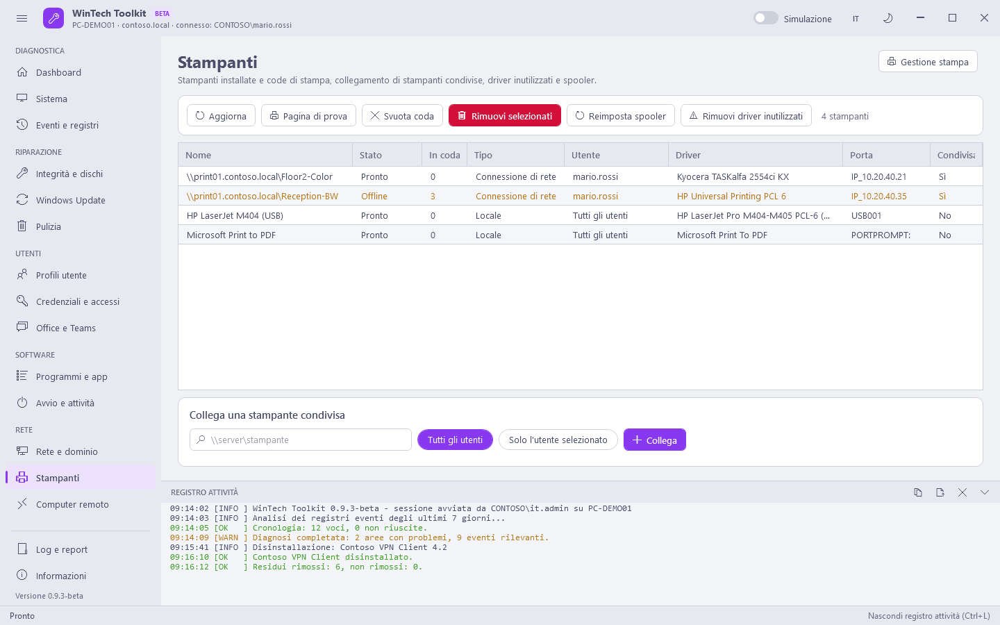

# Rete

[Guida](README.md) · [English](../en/network.md)

## Rete e dominio

Le schede di rete con IP, gateway, DNS e DHCP, poi le azioni.

| Pulsante | Comando | Modifica il sistema |
|---|---|---|
| Rilascia IP / Rinnova IP / Rilascia e rinnova | `ipconfig /release`, `/renew` o entrambi, su tutte le schede | Sì |
| Svuota cache DNS | `ipconfig /flushdns` | Sì |
| Registra nel DNS | `ipconfig /registerdns`: aggiorna il record del PC nel DNS del dominio | Sì |
| Configurazione completa | `ipconfig /all` nel registro attività | No |
| Test di connettività | Gateway, risoluzione DNS, HTTPS verso alcuni siti e proxy WinHTTP | No |
| Test porta (Verifica) | Apre una connessione TCP verso `host:porta` (es. un server sulla 443 o sulla 3389) | No |
| Report Wi-Fi | `netsh wlan show wlanreport`: sessioni Wi-Fi, disconnessioni ed errori degli ultimi giorni (HTML) | No |
| Reimposta Winsock e TCP/IP | `netsh winsock reset`, `netsh int ip reset`, `ipconfig /flushdns`. **Richiede un riavvio** | Sì |
| gpupdate /force | Criteri del computer e dell'utente | Sì |
| gpupdate solo computer | `gpupdate /target:computer /force` | Sì |
| Report dei criteri applicati | `gpresult /h` per il computer e l'utente connesso (HTML) | No |
| Verifica relazione di trust | `Test-ComputerSecureChannel` e `nltest /sc_query` | No |
| Ripara relazione di trust | `Test-ComputerSecureChannel -Repair` con un account autorizzato ad aggiungere computer al dominio (richiesto alla pressione): per "la relazione di trust tra questa workstation e il dominio primario non è riuscita" | Sì |
| Sincronizza ora | `w32tm /resync /force` (Kerberos tollera 5 minuti di differenza) | Sì |
| Riavvia Esplora risorse | Termina e riavvia `explorer.exe`: barra delle applicazioni o desktop bloccati | Sì |

## Stampanti

Le stampanti del computer e le **stampanti di rete di ogni utente connesso**. Una connessione di
rete (`\\server\coda`) appartiene a un solo utente: quando il toolkit gira con un altro account
amministratore Windows non la mostra, quindi viene letta dal registro dell'utente. La colonna
**Utente** indica di chi è; stato, driver e coda sono visibili solo nella sessione di quell'utente.

| Pulsante | Cosa fa | Modifica il sistema |
|---|---|---|
| Pagina di prova | Stampa la pagina di prova di Windows | No |
| Svuota coda | Elimina i lavori in coda delle stampanti selezionate | Sì |
| Rimuovi selezionati | Rimuove le stampanti. La stampante di rete di un altro utente viene rimossa nella sua sessione; viene rimossa anche la connessione per tutti gli utenti (`printui /ga`) | Sì |
| Reimposta spooler | Arresta lo spooler, svuota `C:\Windows\System32\spool\PRINTERS` (lavori bloccati) e lo riavvia | Sì |
| Rimuovi driver inutilizzati | Rimuove i driver non usati da alcuna stampante (driver Microsoft esclusi), anche dall'archivio driver. Prima vengono letti i driver usati nella sessione di ogni utente connesso: se non riesce, non viene rimosso nulla | Sì |
| Collega una stampante condivisa | `\\server\stampante` per **tutti gli utenti** (`printui /ga`, compare al prossimo accesso) o **Solo l'utente selezionato** (subito, nella sua sessione) | Sì |
| Gestione stampa | Apre `printmanagement.msc` | No |

## Computer remoto

Le stesse funzioni su un altro PC tramite **WinRM** (PowerShell remoting): il codice viaggia con la
richiesta, sul PC remoto non si installa nulla. Il PC remoto deve avere WinRM attivo
(`Enable-PSRemoting` o Criteri di gruppo) e la porta 5985 aperta.

| Pulsante | Cosa fa |
|---|---|
| Prova connessione | Verifica che WinRM risponda (anche con un altro account: **Usa un altro account**) |
| Desktop remoto / Gestione computer | Aprono `mstsc` e `compmgmt.msc` sul PC remoto |
| Inventario, Diagnostica problemi, Stato dei dischi, Profili utente, Programmi installati, Amministratori locali, Cronologia aggiornamenti, Analisi pulizia | Sola lettura: il risultato compare nel riquadro sotto (Copia / Salva) |
| Pulizia rapida, Riparazione completa, gpupdate /force, Svuota cache DNS, Sincronizza ora, Reimposta spooler | Modificano il PC remoto (icona rossa) e rispettano la modalità simulazione |
