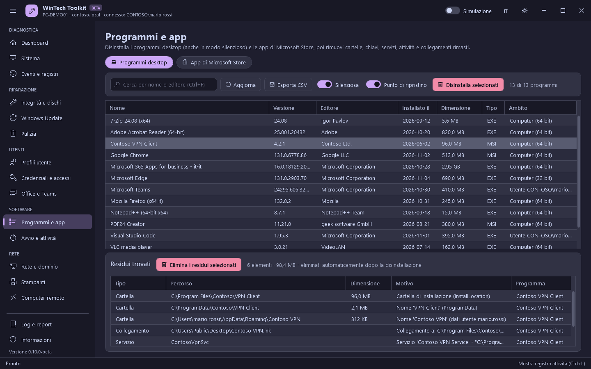

# Software

[Guida](README.md) · [English](../en/software.md)

## Programmi e app

Due schede, caricate entrambe all'avvio del toolkit. Clicca un programma o un'app: i **residui**
che lascerebbe compaiono subito in basso, senza premere nulla.

### Programmi desktop

I programmi di App e funzionalità: installati per il computer (64 e 32 bit) o per un utente.

| Pulsante / interruttore | Cosa fa | Modifica il sistema |
|---|---|---|
| Cerca (Ctrl+F) | Filtra per nome o editore. Se **nessun programma installato** corrisponde a un testo di almeno 4 caratteri (es. `Zoom` già disinstallato), vengono cercati i residui il cui nome lo contiene: così si trova quello che resta dei programmi rimossi senza il toolkit | No |
| Esporta CSV | L'elenco con versione, editore, dimensione, comando di disinstallazione | No |
| Silenziosa | Disinstalla senza finestre: MSI con `msiexec /x {codice} /qn`, altrimenti il `QuietUninstallString` del programma, oppure l'opzione di Inno Setup (`/VERYSILENT`) o NSIS (`/S`) riconosciuta automaticamente. Se non è nota una modalità silenziosa, si apre il programma di disinstallazione normale | - |
| Punto di ripristino | Crea un punto di ripristino prima di disinstallare | - |
| Disinstalla selezionati | Disinstalla, poi **elimina i residui automaticamente** (vedi sotto) | Sì |

Clic destro su un programma: apri la cartella di installazione, apri la sua chiave di registro,
copia il comando di disinstallazione, cerca sul web.

### App di Microsoft Store

Le app Appx/MSIX di tutti gli utenti, con il nome mostrato in Start. Le app necessarie a Windows o
ad altre app (Microsoft Store, App Installer/winget, Sicurezza di Windows, Edge, runtime) sono in
grigio e non vengono mai rimosse.

| Colonna / interruttore | Significato |
|---|---|
| Origine | **Microsoft Store**: firmata dallo Store. **Fuori dallo Store**: firmata dall'editore, può arrivare con Windows o con il produttore del PC, da winget o da un file `.msix`. **Aziendale**: certificato aziendale |
| Installata per | Gli utenti che hanno l'app |
| Nuovi utenti | Sì se l'app è nell'immagine di Windows (viene installata per ogni nuovo utente) |
| Anche per i nuovi utenti | Rimuove l'app anche dall'immagine di Windows (`Remove-AppxProvisionedPackage`), così non torna per i nuovi utenti |
| Rimuovi le app selezionate | `Remove-AppxPackage -AllUsers`, poi elimina i residui automaticamente |

### Residui

Dopo una disinstallazione il toolkit cerca quello che il programma ha lasciato e **lo elimina
automaticamente**:

| Tipo | Dove |
|---|---|
| Cartelle | Cartella di installazione, Programmi, ProgramData, AppData di ogni utente (anche la cartella dell'editore, se resta vuota) |
| Collegamenti | Menu Start e desktop (anche quelli che puntano alle cartelle eliminate) |
| Registro | Chiavi con il nome del programma o dell'editore (HKLM e ogni utente caricato), la voce di disinstallazione, la registrazione di Windows Installer |
| Servizi e attività | Servizi e attività pianificate che avviano file dalle cartelle eliminate |
| App dello Store | `AppData\Local\Packages\<app>` di ogni profilo e, per gli utenti connessi, impostazioni dell'app, registrazione del pacchetto e associazioni dei file nel registro |

Regole di sicurezza:

- i residui si eliminano automaticamente **solo se la disinstallazione è riuscita**: altrimenti
  comprenderebbero i file di un programma ancora installato, quindi vengono mostrati da controllare;
- le chiavi di registro vengono salvate in `.reg` prima di essere eliminate; i processi avviati
  dalle cartelle vengono chiusi;
- non vengono mai proposti nomi usati da altri programmi installati, nomi generici o di sistema
  (Microsoft, Windows, Common Files...) e i percorsi protetti;
- le cartelle con file in uso vengono eliminate al riavvio successivo: in quel caso, e quando lo
  chiede il programma di disinstallazione, un messaggio propone di **riavviare ora** (tra 60 secondi).

**Elimina i residui selezionati** elimina solo le righe selezionate (`Ctrl+A` seleziona tutto),
senza disinstallare: per i residui di programmi già rimossi. Se il programma è ancora installato,
la conferma avvisa che potrebbe smettere di funzionare.

## Avvio e attività

| Pulsante | Cosa fa | Modifica il sistema |
|---|---|---|
| Programmi all'avvio: Disabilita / Abilita | Le chiavi Run (computer, 32 bit, ogni utente caricato) e le cartelle Esecuzione automatica. La disabilitazione usa le chiavi `StartupApproved`, come Gestione attività: non si elimina nulla e **Abilita** la ripristina | Sì |
| Attività pianificate: Disabilita / Abilita | `Disable-ScheduledTask` / `Enable-ScheduledTask`. Le attività di Windows sono nascoste, a meno di attivare **Includi attività di Windows** | Sì |
| Gestione attività / Utilità di pianificazione | Aprono le console di Windows | No |
