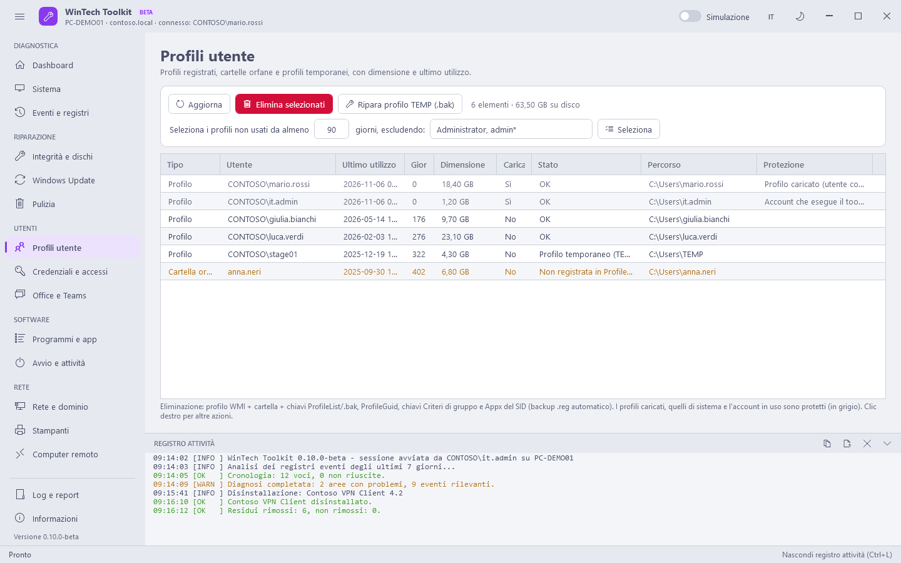

# Utenti

[Guida](README.md) · [English](../en/users.md)

Molti problemi degli utenti stanno nella loro sessione (credenziali, ticket Kerberos, accesso a
Office, OneDrive). Il toolkit gira spesso con un account amministratore diverso: queste azioni
vengono eseguite **nella sessione dell'utente connesso** tramite un'attività pianificata
temporanea, eliminata al termine. Sono indicate con "Sessione" e richiedono che l'utente sia
connesso (pallino accanto al nome).

## Profili utente

L'elenco dei profili con ultimo utilizzo reale, dimensione, stato e motivo per cui un profilo è
protetto.

| Tipo / stato | Significato |
|---|---|
| Profilo | Un profilo registrato (ProfileList) |
| Backup .bak | Una chiave `<SID>.bak`: Windows non è riuscito a caricare il profilo e ne ha creato uno temporaneo |
| Profilo temporaneo (TEMP) | L'utente accede a `C:\Users\TEMP`: i suoi dati non sono persi, vedi **Ripara profilo TEMP** |
| Cartella orfana | Una cartella in `C:\Users` non collegata ad alcun profilo (residuo di un account eliminato) |
| Cartella mancante | Profilo registrato la cui cartella non esiste più |

| Pulsante | Cosa fa | Modifica il sistema |
|---|---|---|
| Seleziona (giorni, escludendo) | Seleziona i profili non usati da almeno N giorni, tranne i nomi in elenco (ammessi i caratteri jolly, es. `admin*`) | No |
| Elimina selezionati | Elimina il profilo WMI, la cartella, le chiavi ProfileList e `.bak`, ProfileGuid, le chiavi Criteri di gruppo e Appx del SID. Ogni chiave viene prima salvata in `.reg` | Sì |
| Ripara profilo TEMP (.bak) | Elimina la chiave del SID che punta a TEMP e rinomina `SID.bak` in `SID`, azzerandone lo stato: al prossimo accesso l'utente ritrova il suo profilo | Sì |

Mai mostrati e mai eliminati: profili caricati (utente connesso), l'account con cui gira il
toolkit, profili di sistema, percorsi fuori da `C:\Users` e gli account che Windows crea per sé
(`defaultuser0`, `defaultuser100000`, `WsiAccount`).

## Credenziali e accessi

| Pulsante | Cosa fa | Modifica il sistema |
|---|---|---|
| Leggi credenziali | Sessione · elenca le voci di Gestione credenziali dell'utente selezionato | No |
| Elimina selezionati | Sessione · elimina le voci selezionate (dopo un cambio password, le vecchie password salvate bloccano l'account) | Sì |
| Seleziona Office/Teams/OneDrive | Seleziona le voci di Microsoft 365, per accedere di nuovo da zero | No |
| Mostra ticket utente | Sessione · `klist` | No |
| Elimina ticket utente | Sessione · `klist purge`: nuovi gruppi e password valgono senza disconnettersi | Sì |
| Elimina ticket del computer | `klist -li 0x3e7 purge`: i nuovi gruppi del computer valgono senza riavviare | Sì |
| Reimposta PIN e Windows Hello | Sessione · `certutil -DeleteHelloContainer`: per "PIN non disponibile" o "si è verificato un problema con il PIN". L'utente imposta un nuovo PIN al prossimo accesso | Sì |
| Gruppi locali: Aggiungi | `net localgroup <gruppo> <membro> /add` su Administrators, Remote Desktop Users o Utenti (`DOMINIO\utente`, `DOMINIO\gruppo`, `AzureAD\utente@dominio` o un utente locale) | Sì |
| Gruppi locali: Rimuovi selezionati | Rimuove i membri tramite ADSI (`WinNT://`), che funziona anche con i SID orfani. Le modifiche valgono dal prossimo accesso dell'utente | Sì |

I SID orfani (account che non esistono più) sono mostrati in giallo e si possono rimuovere;
l'account in uso e l'amministratore predefinito sono protetti.

## Office e Teams

| Pulsante | Cosa fa | Modifica il sistema |
|---|---|---|
| Ripristino rapido | `OfficeClickToRun.exe scenario=Repair RepairType=QuickRepair`: offline, pochi minuti, risolve la maggior parte degli arresti anomali | Sì |
| Ripristino online | Come sopra con `RepairType=FullRepair`: reinstalla Office da Internet (lento) | Sì |
| Aggiorna Office | `OfficeC2RClient.exe /update user`: avvia la verifica degli aggiornamenti | Sì |
| Svuota cache di Teams | Chiude Teams e svuota la cache del nuovo Teams (pacchetto `MSTeams`) e di Teams classico: lentezza, chat o immagini che non si caricano | Sì |
| Reimposta accesso e licenza | Sessione · rimuove le chiavi Office Identity, Licensing e Registration, le cache di identità (IdentityCache, OneAuth) e le credenziali di Office salvate: per richieste continue di accesso o "prodotto senza licenza" | Sì |
| Ricrea cache di Outlook | Rinomina i file `.ost`: Outlook riscarica la casella di posta | Sì |
| Outlook in modalità provvisoria | Sessione · `outlook /safe`, senza componenti aggiuntivi | No |
| Reimposta riquadro di spostamento | Sessione · `outlook /resetnavpane`: Outlook non si apre o si chiude subito | Sì |
| Reimposta OneDrive | Sessione · `onedrive.exe /reset` e riavvio del client: sincronizzazione bloccata. I file locali restano | Sì |
